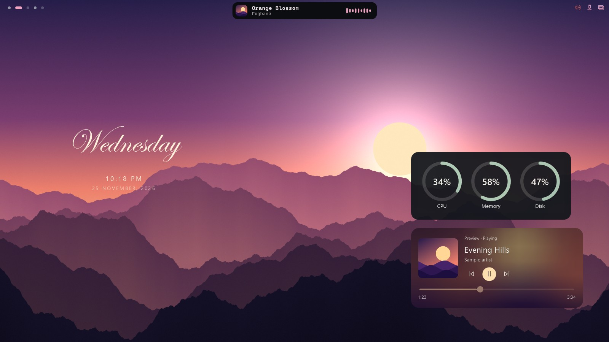
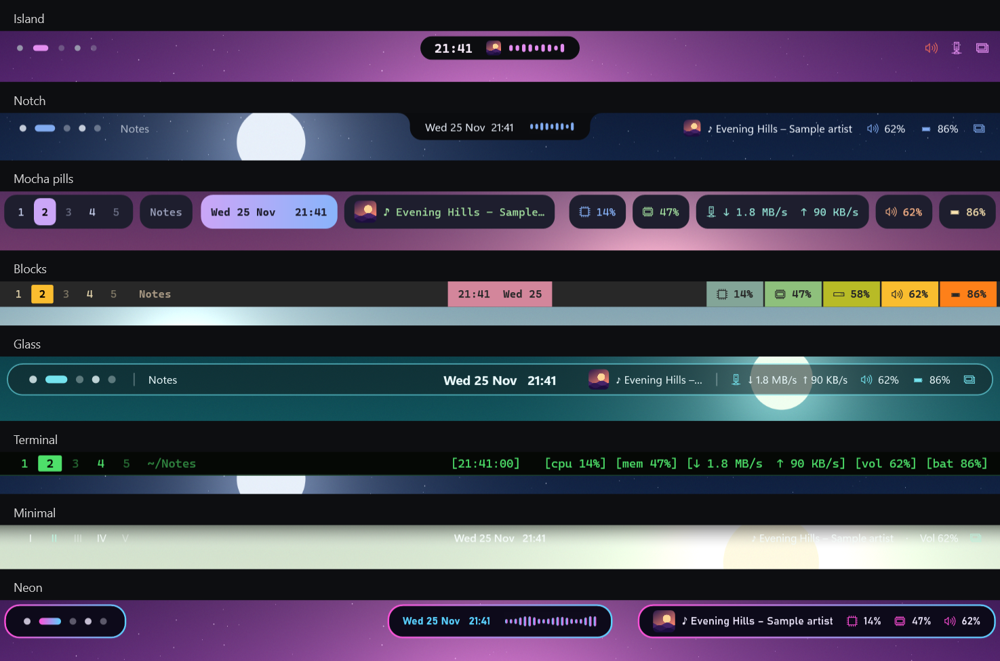
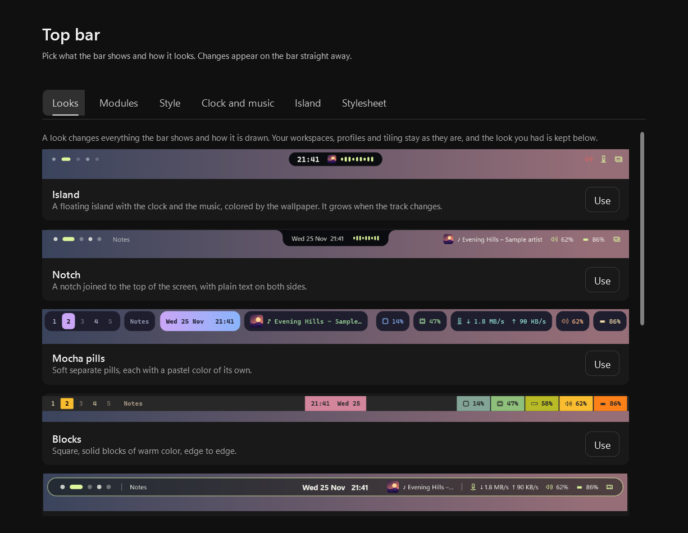
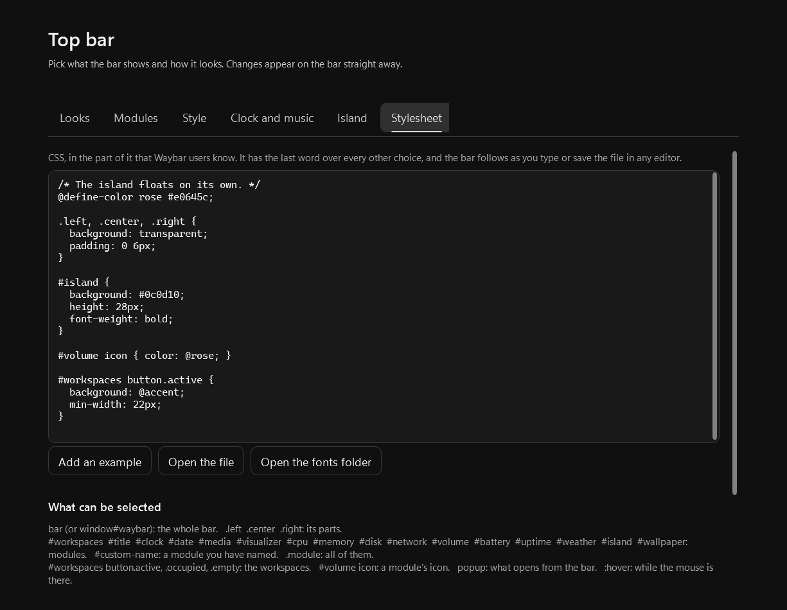
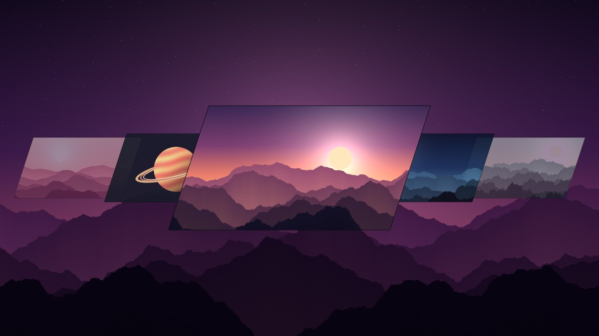
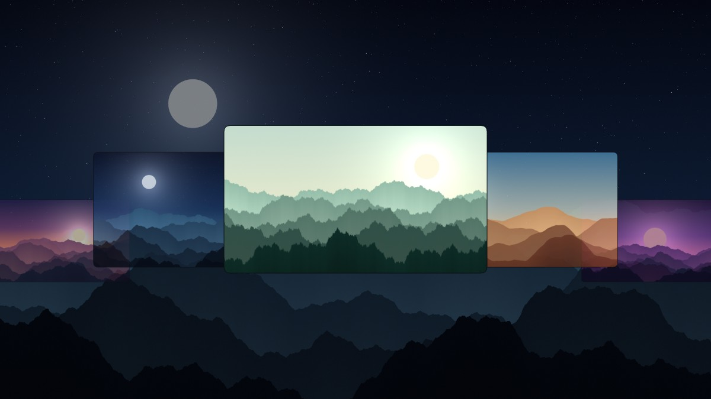
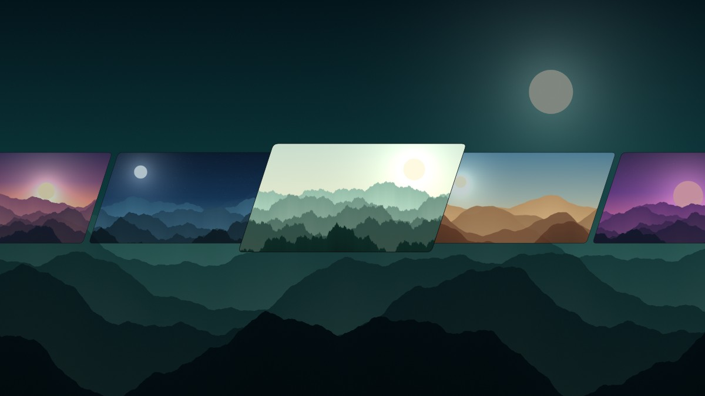
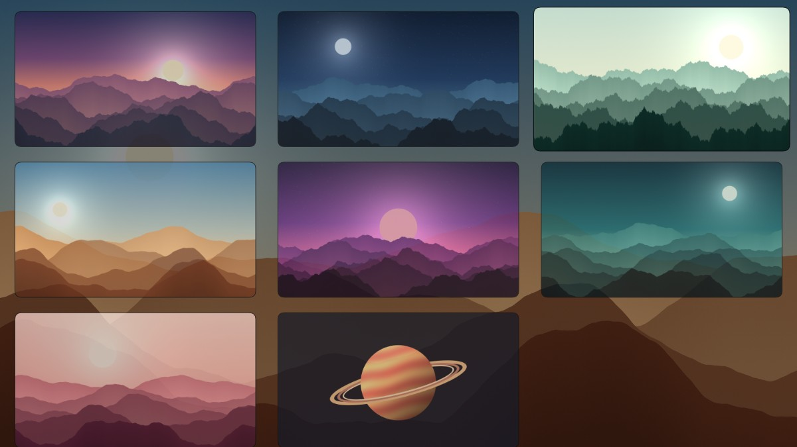
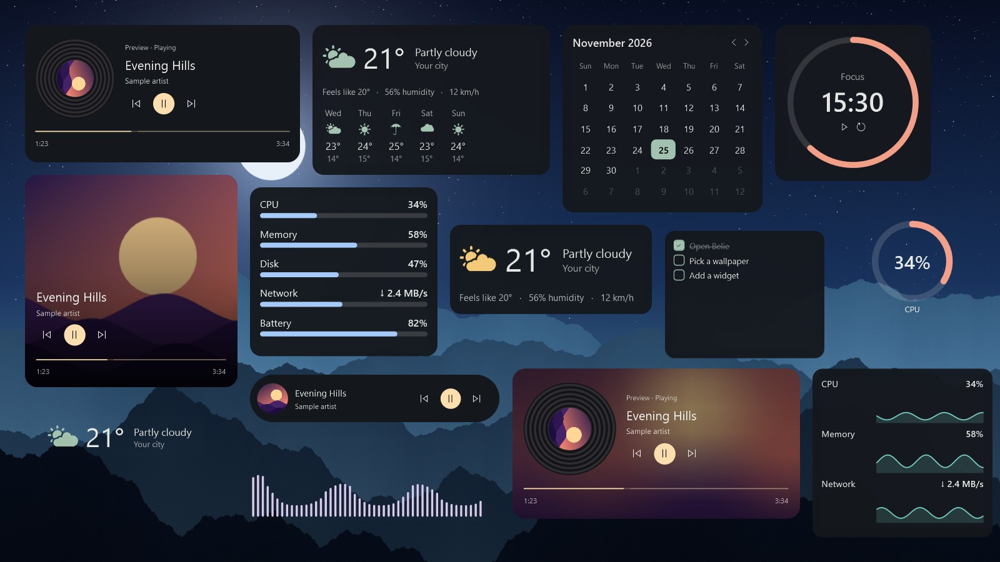
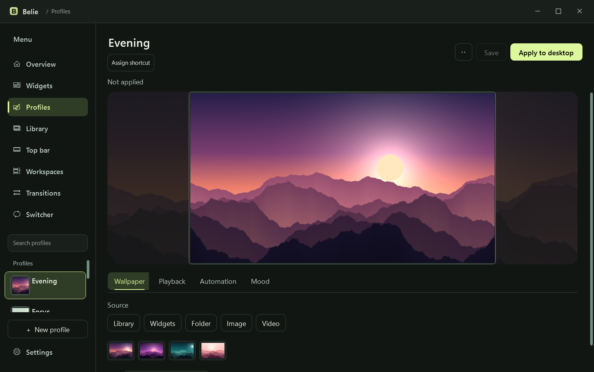

<div align="center">

# Belie

**Your whole Windows desktop, your way.**

Wallpaper profiles, a top bar you can restyle with CSS, workspaces and desktop widgets, in one app that lives in the tray.

[](https://github.com/el-rato/Belie/releases/latest/download/Belie-win-Setup.exe)
[](#install)
[](#build-it-yourself)



</div>

<p align="center">
  <a href="#a-bar-you-can-rice">Top bar</a> ·
  <a href="#workspaces">Workspaces</a> ·
  <a href="#wallpaper-switcher">Switcher</a> ·
  <a href="#transitions">Transitions</a> ·
  <a href="#widgets">Widgets</a> ·
  <a href="#profiles">Profiles</a> ·
  <a href="#install">Install</a> ·
  <a href="docs/USER_GUIDE.md">User guide</a> ·
  <a href="CHANGELOG.md">Patch notes</a>
</p>

> **New in 4.1:** the top bar draws over your windows and slides out of their way, apps remember which workspace they open on, and hovering a workspace shows a preview of it. [Read the patch notes](CHANGELOG.md).

## A bar you can rice

Pick one of eight looks and make it yours. Every module, part and workspace dot can be restyled, colors can follow the wallpaper, and your look can be shared as a single file.



- **Out of the way when you work.** The bar draws over your windows and slides away while one is under it, so they get the whole screen. Rest the pointer at the top edge to bring it back; a quick click there, such as on a browser tab, still reaches the app. It can also keep its own strip, like the taskbar.
- **An island that grows** to show a new track, the volume or the workspace.
- **20 kinds of module:** workspaces, window title, clock, date, media, visualizer, CPU, memory, disk, network, volume, battery, uptime, weather, launchers, your own text, your own scripts and more.
- **A stylesheet** in the part of CSS that Waybar users know. The bar follows as you type, or as you save the file in any editor.
- **Clicks and scrolls** on any module can run a command or one of Belie's actions, such as `belie:wallpapers` or `belie:next-track`.

<table>
  <tr>
    <td width="50%"></td>
    <td width="50%"></td>
  </tr>
  <tr>
    <td align="center">Looks</td>
    <td align="center">Stylesheet</td>
  </tr>
</table>

```css
@define-color rose #e0645c;

.left, .center, .right { background: transparent; padding: 0 6px; }

#island { background: #0c0d10; height: 28px; font-weight: bold; }
#volume icon { color: @rose; }
#workspaces button.active { background: @accent; min-width: 22px; }
```

## Workspaces

Every monitor gets its own set of workspaces. Windows on the others are hidden and leave the taskbar until you return, and switching slides or fades between them.

| Keys | What they do |
| --- | --- |
| `Alt` + `1`–`9` | Open a workspace |
| `Alt` + `Shift` + `1`–`9` | Send the window there |

- **Apps remember their workspace.** Send a window to a workspace once, and its app opens there from then on and takes you along.
- **Previews.** Hover a workspace on the bar to see how you left it and which windows are on it.
- **Popouts stay with you.** Picture-in-picture videos, mini players and calls stay visible on every workspace.
- **A profile per workspace.** Opening a workspace can change the wallpaper with it, while your schedules and triggers keep running.

## Wallpaper switcher

Press `Ctrl` + `Alt` + `W` to go through the wallpapers of the profile you are on. The slideshow carries on from the one you pick, and the profile remembers it.



<table>
  <tr>
    <td width="33%"></td>
    <td width="33%"></td>
    <td width="33%"></td>
  </tr>
  <tr>
    <td align="center">Carousel</td>
    <td align="center">Filmstrip</td>
    <td align="center">Grid</td>
  </tr>
</table>

Move with the arrow keys or the wheel, press `Enter` to choose, `Tab` to look through another profile and `Esc` to leave. `Ctrl` + `Alt` + `PageDown` and `PageUp` step through wallpapers without opening it.

## Transitions

When the new picture has a clear subject, Belie dims the old wallpaper, draws the subject's outline over it and lets the new one spread from there. Otherwise choose from pixel colonies, grow, shrink, wipe, wave, blinds, spiral, dissolve and fade.


## Widgets

Put widgets on the desktop and drag them where they belong. Each wallpaper can have its own spots for them.



- **Clocks:** ten designs, from script to terminal.
- **Music:** nine players, including a turning record, a progress ring and a slim capsule.
- **Visualizers:** eight styles that react to what your PC is playing.
- **Everyday:** system readings, weather, calendar, checklist, focus timer and notes.

## Profiles

A profile is a set of wallpapers with a fit, a slideshow and rules. Pictures, folders, videos and GIFs all work.



- Switch **by hand**, with a **keyboard shortcut**, on a **schedule**, or when something **happens**: on battery, idle, or when a program starts.
- **Live wallpapers** from videos and GIFs, with no other app needed.
- **Discover** finds wallpapers on Wallhaven, with a content filter.
- **13 themes** for the app itself.

## Install

[**Download the installer**](https://github.com/el-rato/Belie/releases/latest/download/Belie-win-Setup.exe) and run it. For a portable copy, extract the whole `Belie-win-Portable.zip` from the [latest release](https://github.com/el-rato/Belie/releases/latest).

Already using Belie? Open **Settings → App updates → Check for updates**, then choose **Update and restart**. Your profiles and settings stay.

> Windows SmartScreen may say "Windows protected your PC", because the app is not code-signed. Choose **More info → Run anyway**.

**Start with:**

1. **Profiles:** add a folder of pictures and press **Apply to desktop**.
2. **Top bar:** turn on **Show the top bar**, then pick a look.
3. **Workspaces:** optional, with or without the bar. Turn on **Use workspaces** here.
4. **Widgets:** press **Add widget**, then **Browse the gallery**.

Closing the window leaves Belie in the tray. Right-click its icon and choose **Exit** to quit.

## Privacy

Your settings stay on your PC, in `%AppData%\Belie`. Sound for visualizers is analyzed in memory and thrown away. Belie goes online only for updates (GitHub), Discover (Wallhaven) and the weather, when you use them. A look from someone else can contain commands, so Belie shows them and asks before using them.

## Build it yourself

You need the [.NET 8 SDK](https://dotnet.microsoft.com/download/dotnet/8.0).

```
dotnet build -c Debug
dotnet test WallpaperProfiles.Tests\WallpaperProfiles.Tests.csproj
```

The [codebase guide](docs/CODEBASE_GUIDE.md) explains how the source is laid out, and the [user guide](docs/USER_GUIDE.md) covers releases, the command line, where data is kept and troubleshooting.

<sub>The wallpapers in these pictures were drawn for this page. The music and readings are samples.</sub>
